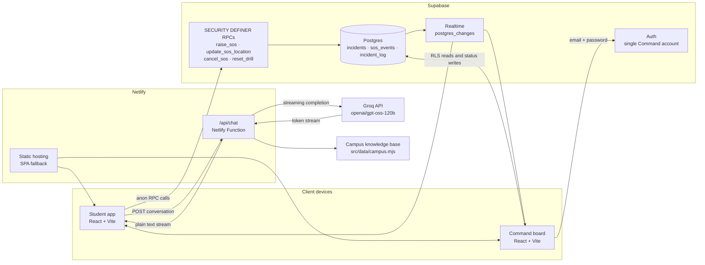
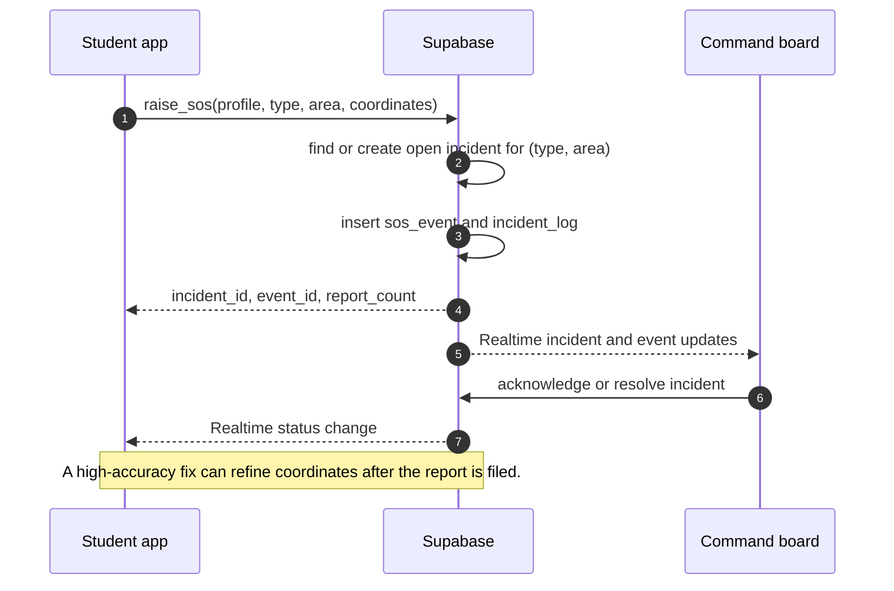

<div align="center">

# PRAHARI

**Campus safety drill platform**

A real-time SOS workflow with a student web app, a command board, and a grounded campus safety assistant.

React 18 · Vite 5 · Supabase · Netlify Functions · Groq

</div>

---

## Overview

Prahari connects two interfaces through one live incident loop:

- **Student** — a mobile-first web app. Students create a local profile, choose an emergency type, optionally pick an area, and hold the SOS button for two seconds. The alert reaches the Command board instantly.
- **Command** — an operations board for wardens, security, medical, and fire staff. Alerts are grouped by emergency type and area, acknowledged, resolved, and tracked with a live timeline.
- **Assist** — a safety information assistant inside the student app. It answers from a controlled campus knowledge base and never claims to have contacted anyone.

The project is designed for campus safety rehearsals and drill exercises, with real-time grouping and acknowledgement behaviour that mirrors a production incident workflow.

---

## Capabilities

| Area | What it does |
|---|---|
| Student onboarding | Local-only profile with name, roll number, hostel, and optional room. No student accounts or signup. |
| SOS | Hold-to-send with a two-second confirmation, emergency type selection, and optional area. Full-screen sending state prevents duplicate sends. |
| Active incident | Live status, acknowledgement and resolution updates, timeline, elapsed time, location evidence, and pre-acknowledgement withdrawal. |
| Location | Cached-first GPS capture. Sends immediately with an available fix, then refines with a high-accuracy update after the alert is filed. Works with location denied. |
| Command board | Live incident panels, grouped reports, acknowledgement, resolution, append-only log, shared siren, speaker test, reset drill, and simulated burst. |
| Assist | Streaming chat interface, suggested questions, conversation persistence, retry handling, and a helpline sheet rendered from the same knowledge base. |
| Helplines | National and campus numbers grouped by scope, with tap-to-call links. Campus entries are explicitly marked as sample data. |
| Design | Responsive iOS-inspired interface with light and dark themes, reduced-motion support, reduced-transparency fallbacks, and 44px minimum touch targets. |

---

## Architecture



### SOS data flow



### Request routing

| Path | Served by | Purpose |
|---|---|---|
| `/` | Vite / Netlify | Student app |
| `/command` | Vite / Netlify SPA fallback | Command login and board |
| `/api/chat` | Netlify Function | Server-side Groq proxy with streaming |
| `/rest/v1/*` | Supabase | RPCs, RLS-protected reads, status updates |
| `/realtime/v1/*` | Supabase | Live incident and event subscriptions |

---

## Technology

| Layer | Choice | Role |
|---|---|---|
| UI | React 18 + Vite 5 | Student app and Command board |
| Styling | Hand-authored CSS tokens | iOS-inspired light and dark themes |
| Font | Inter Variable via Fontsource | Consistent typography with an Apple system-font stack |
| Data | Supabase Postgres | Incidents, SOS events, and append-only audit log |
| Realtime | Supabase Realtime | Live updates for students and Command |
| Auth | Supabase Auth | One Command account; students remain anonymous |
| Functions | Netlify Functions | Server-side Groq proxy and rate limiting |
| AI | Groq `openai/gpt-oss-120b` | Retrieval-grounded safety information |
| Hosting | Netlify | Static SPA, HTTPS, and serverless functions |
| Icons | lucide-react | Interface iconography |
| Testing | Node + Postgres | Concurrent schema tests and load verification |

---

## Repository layout

```text
prahari/
├─ netlify/
│  └─ functions/
│     └─ chat.mjs              # /api/chat Groq proxy, streaming, rate limit
├─ public/
│  ├─ _redirects               # SPA fallback for /command
│  └─ favicon.ico              # App icon
├─ pgtest/
│  └─ test-schema.mjs          # Postgres schema and concurrency suite
├─ scripts/
│  └─ load-test.mjs            # Concurrent raise_sos acceptance test
├─ src/
│  ├─ App.jsx                  # / vs /command routing
│  ├─ config.js                # Types, areas, panels, brand constants
│  ├─ data/
│  │  └─ campus.mjs            # Campus knowledge base + helplines (sample data)
│  ├─ lib/
│  │  ├─ assistClient.js       # Streaming /api/chat client
│  │  ├─ assistStore.js        # Local conversation persistence
│  │  ├─ haptic.js             # No-op-safe vibration helper
│  │  ├─ location.js           # Cached-first GPS + post-send refinement
│  │  ├─ mock-supabase.js      # In-browser demo backend
│  │  ├─ session.js            # Local profile, session UUID, active SOS
│  │  ├─ supabase.js           # Real or mock Supabase client
│  │  └─ ui.jsx                # Toasts, chips, timers, hold actions
│  ├─ student/
│  │  ├─ Assist.jsx            # Chat, suggestions, helpline sheet
│  │  ├─ ActiveSOS.jsx         # Live incident state and withdrawal
│  │  ├─ BottomNav.jsx         # Glass tab bar
│  │  ├─ Dashboard.jsx         # Profile, type selector, area, SOS
│  │  ├─ HelplineSheet.jsx     # Emergency numbers bottom sheet
│  │  ├─ HoldButton.jsx        # Two-second hold gesture
│  │  ├─ Onboarding.jsx        # Local profile form
│  │  ├─ StudentApp.jsx        # Student state and routing
│  │  └─ StudentShell.jsx      # Shell and tab switching
│  └─ styles/
│     ├─ base.css              # Reset, type scale, glass, motion
│     ├─ components.css        # Student interface components
│     ├─ tokens.css            # Colour, spacing, motion, layout tokens
│     ├─ legacy.css            # Operational Paper primitives for Command
│     └─ command.css           # Command board styles
├─ supabase/
│  └─ schema.sql               # Tables, indexes, RLS, RPCs, realtime setup
├─ netlify.toml                # Build, publish, functions, Node 20
├─ VERIFICATION.md             # Requirement and verification report
└─ README.md
```

---

## Getting started

### Prerequisites

- Node.js 20 or newer
- npm
- A Supabase project for the real backend
- A Groq API key for Assist
- Netlify CLI for local function development and deployment

### 1. Install

```bash
npm install
```

### 2. Run the demo (no backend required)

```bash
npm run dev:demo
```

Open the printed URL for the student app and `/command` for the Command board. In demo mode, Command accepts any email and password. The in-browser mock backend emulates RPC grouping, realtime updates, acknowledgement, resolution, cancellation, and drill reset through `BroadcastChannel`.

Demo mode is for local rehearsal only and is never enabled in production builds.

### 3. Connect a real Supabase project

1. Create a project at [supabase.com](https://supabase.com).
2. Open the SQL Editor and run the full contents of `supabase/schema.sql`.
3. Disable public signup under **Authentication → Sign In / Providers**.
4. Create the single Command account under **Authentication → Users**.
5. Copy the Project URL and anon public key from **Project Settings → API**.
6. Create `.env` from `.env.example` and fill in the values.

```bash
cp .env.example .env
npm run dev
```

`VITE_SUPABASE_URL` and `VITE_SUPABASE_ANON_KEY` are read by the browser build. The anon key is safe to expose; RLS and `SECURITY DEFINER` RPCs enforce access. Never expose the service-role key to the frontend.

### 4. Run Assist locally

Vite alone does not serve the Netlify Function. Use Netlify Dev so both the SPA and `/api/chat` are available:

```bash
npx --yes netlify-cli@latest dev --offline
```

Add `GROQ_API_KEY` and, optionally, `GROQ_MODEL` to `.env`. Without a key, `/api/chat` returns a clear `503` configuration error and the rest of the app continues to work.

### 5. Deploy to Netlify

1. Connect the repository to Netlify.
2. Confirm the build command is `npm run build` and the publish directory is `dist`.
3. Add the environment variables listed below.
4. Deploy. HTTPS is enabled automatically.

The SPA fallback in `public/_redirects` keeps `/command` working on direct navigation and refresh.

---

## Environment variables

| Variable | Scope | Required | Description |
|---|---|---|---|
| `VITE_SUPABASE_URL` | Client build | Yes | Supabase project URL |
| `VITE_SUPABASE_ANON_KEY` | Client build | Yes | Supabase anon public key |
| `GROQ_API_KEY` | Netlify Function | Yes for Assist | Server-side Groq key. Never prefix with `VITE_`. |
| `GROQ_MODEL` | Netlify Function | No | Defaults to `openai/gpt-oss-120b` |
| `VITE_PRDH_DEMO` | Local only | No | Enables the in-browser mock backend for `npm run dev:demo` |

Do not set `VITE_PRDH_DEMO` in production.

---

## How it works

### Race-safe incident grouping

Grouping happens in Postgres, never in the client. `raise_sos` creates or updates an open incident keyed by `(type, area)` and increments `report_count` atomically. A partial unique index guarantees that only one open incident can exist for each pair:

```sql
create unique index one_open_incident
  on public.incidents (type, area)
  where status in ('active', 'acknowledged');
```

A second partial index prevents more than one active report per student session:

```sql
create unique index one_active_report
  on public.sos_events (session_id)
  where status = 'active';
```

This makes concurrent bursts deterministic: the same pair produces one incident with an accurate report count, while different pairs remain separate.

### Security model

| Table | Anonymous student | Authenticated Command |
|---|---|---|
| `incidents` | `SELECT` | Full access |
| `sos_events` | No direct access; writes only through RPCs | `SELECT` |
| `incident_log` | No access | `SELECT` |

Students never read another student's name, roll number, room, or coordinates. Realtime delivery also respects RLS. Command authentication is restricted to one account created manually in Supabase.

### Location handling

1. A warm geolocation watch starts when the dashboard opens. Nothing leaves the device.
2. On send, the best cached fix is attached immediately if available.
3. After the incident is filed, a high-accuracy `getCurrentPosition` call refines the coordinates through `update_sos_location`.
4. If permission is denied or no fix exists, the SOS still sends. Grouping never depends on GPS.

Hostel and room are stored as a residence hint for responders. They are never used as grouping keys.

### Realtime and recovery

- Command refetches incidents and events on subscription and on tab visibility changes.
- Student active-incident screens subscribe to their incident channel and also poll every 15 seconds, so a drill reset or a missed realtime event resolves cleanly.
- Command status changes propagate to the student screen as live acknowledgements and resolutions.

### Shared siren

The Command board runs one siren for all active incidents. The siren is derived from `anyActive && onDuty`, so a second alert never starts a second loop. Audio is synthesized with the Web Audio API at 650/950 Hz, avoiding audio-file load failures. The on-duty gesture unlocks audio, and the test button provides a short two-tone sample.

### Assist safeguards

- The Groq key stays on the server. The browser only calls `/api/chat`.
- Requests are limited to 12 turns and 2,000 characters per message.
- The function applies a per-IP rate limit of 12 requests per minute.
- The model receives a system prompt built from `src/data/campus.mjs` and is instructed to use only that knowledge.
- In an active emergency, the first response directs the user to the SOS button and a relevant helpline.
- Campus contact details are sample data and are labelled as such in the interface.
- Responses stream to the client as plain text; cancellation and retry are handled by the chat UI.

---

## Data model

| Object | Purpose |
|---|---|
| `incidents` | One open or closed incident per `(type, area)` pair, including status, report count, acknowledgement, resolution, and timing fields |
| `sos_events` | One row per student report, including profile snapshot, residence hint, coordinates, accuracy, and status |
| `incident_log` | Append-only audit timeline for incident changes |
| `raise_sos(...)` | Validates input, groups the incident, inserts the event, writes the log, and returns incident and event identifiers |
| `update_sos_location(...)` | Refines coordinates after send while the report is active |
| `cancel_sos(...)` | Withdraws an unacknowledged report and updates the incident count |
| `reset_drill()` | Command-only truncation of all three tables between exercises |

The full schema, policies, grants, indexes, and function bodies live in `supabase/schema.sql`.

---

## Design system

The student interface uses a token-driven Apple-inspired visual language:

- `src/styles/tokens.css` — colours, radii, spacing, motion, and layout tokens for light and dark themes.
- `src/styles/base.css` — reset, type scale, glass material, press feedback, entrance animations, and accessibility fallbacks.
- `src/styles/components.css` — student components, including the segmented control, SOS button, tab bar, chat composer, incident cards, and helplines.
- `src/styles/legacy.css` and `src/styles/command.css` — the Operational Paper system used by the Command board.

Reduced-motion and reduced-transparency preferences are respected. The SOS gesture remains purely time-based and is never delayed by animation.

---

## Scripts

| Command | Description |
|---|---|
| `npm run dev` | Start Vite against the configured Supabase project |
| `npm run dev:demo` | Start Vite with the in-browser mock backend |
| `npm run build` | Build the production SPA into `dist/` |
| `npm run preview` | Preview the production build |
| `npm run preview:demo` | Preview the demo build |
| `npm run loadtest -- --url ... --key ... --n 70 --mode mixed` | Run the concurrent SOS acceptance test |

---

## Load testing

The load test fires concurrent `raise_sos` calls with unique sessions, mixed types, selected areas, and unspecified areas. It verifies that every call succeeds, that exactly one open incident exists per pair, and that report counts match arrivals.

```bash
node scripts/load-test.mjs \
  --url https://YOUR-PROJECT.supabase.co \
  --key YOUR_ANON_KEY \
  --n 70 \
  --mode mixed
```

Available modes are `mixed`, `spread`, and `same`. Exit code `0` indicates a pass.

---

## Documentation

- [`VERIFICATION.md`](VERIFICATION.md) — requirement-by-requirement verification notes and checks.
- [`supabase/schema.sql`](supabase/schema.sql) — database definition and RPCs.
- [`netlify/functions/chat.mjs`](netlify/functions/chat.mjs) — assistant proxy and safeguards.

---

Built by **HPS Labs**
